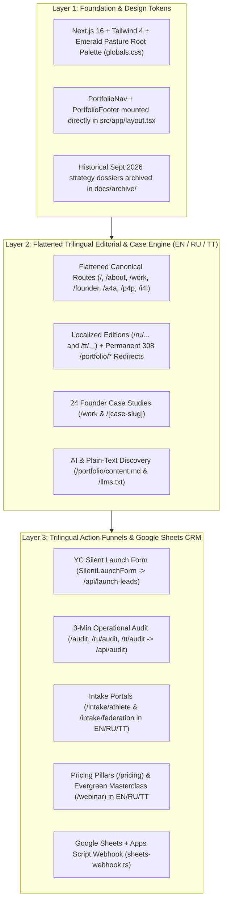
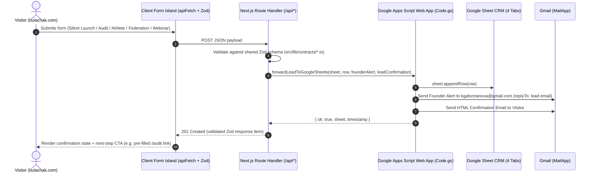

# Bulachak (`bulachak.com`) — Current State, Architecture & Rebuild Baseline

> **Purpose of this document:** This document records the canonical state of the **Bulachak** (`https://bulachak.com`) codebase, live production infrastructure, flattened trilingual route map (`114` localized routes), Google Sheets + Apps Script CRM pipeline, and editorial guardrails as of **October 14, 2026** (following the completion of the October 14 platform rebuild).
>
> 📋 **For the itemized file-by-file change log of the October 14, 2026 rebuild, see [`docs/REBUILD_PLAN_AND_CHANGELOG.md`](./REBUILD_PLAN_AND_CHANGELOG.md).**

---

## 1. Executive Summary & Live Infrastructure

**Bulachak** (`https://bulachak.com`) is a trilingual (`en`, `ru`, `tt`) venture platform, operational diagnostic web application, and founder work archive created by **Kamilla Gafurzianova, OLY**.

Bulachak ("the future" in Tatar) connects three branches under the **Emerald Pasture** philosophy of co-opetition:
1. **A4A · Agents 4 Athletes** — Commercial engine building turnkey digital operations, registration/waiver/billing pipelines, and AI-assisted back offices for sports clubs, academies, coaches, and athlete-founders.
2. **P4P · Parafencing 4 Progress** — Nonprofit adaptive-fencing branch in development, expanding access to wheelchair fencing frames, mounting rigs, coach certification, and sustainable club programs (backed by an unconditional **4% gross revenue pledge** from A4A).
3. **I4I · Immigrant 4 Immigrant** — Community kinship, cultural continuity, and mutual operational support across immigrant founders and families.

### Production Environment Matrix

| Surface | Canonical Value / Identifier | Notes |
|---|---|---|
| **Production Domain** | `https://bulachak.com` | Served via Vercel Edge Network (DNS managed on Cloudflare). |
| **Vercel Project** | `milamanzareks-projects/a4a-p4p` (`prj_9j3yWsPquD6cZANQszkjYwcvsAk9`) | Node 24.x runtime, Next.js 16.2.6 (App Router + Turbopack). |
| **GitHub Repository** | `Bulachak/bulachak-website` (`origin/main`) | Local workspace: `c:\Users\kamil\PROJECTS\a4a-p4p`. |
| **Canonical Contact** | `kgafurzianova@gmail.com` · [LinkedIn](https://www.linkedin.com/in/kamilla-gafurzianova/) | Defined in [`src/lib/portfolio-brand.ts`](../src/lib/portfolio-brand.ts). |
| **CRM Google Sheet** | [`19f83qdQCUhe4dWvOLSWmc5_xBNLmfUm8I4_kk-L5r2o`](https://docs.google.com/spreadsheets/d/19f83qdQCUhe4dWvOLSWmc5_xBNLmfUm8I4_kk-L5r2o/edit) | *Bulachak — Silent Launch & Intake CRM (bulachak.com)* (4 tabs). |
| **Bound Apps Script** | `1i8zZqaDxLUd8VIr1uo42jtqkvN_JXZxQ-Q7RdVlk-ZZPl7Q-rsWX8Fb5` | Source tracked in [`scripts/google-apps-script/Code.gs`](../scripts/google-apps-script/Code.gs). |
| **Vercel Env Vars** | `NEXT_PUBLIC_APP_URL=https://bulachak.com` `GOOGLE_SHEETS_WEBHOOK_URL=https://script.google.com/macros/s/.../exec` | Configured on Vercel (`production`, `preview`, `development`). Polsia variables removed. |

---

## 2. How the Codebase Evolved (Three Historical Layers → Unified Platform)

1. **Layer 1 — Foundation & Unified Design System:**
   - Next.js 16 App Router with the **Bulachak Emerald Pasture** palette (`#f6faf7` / `#1d332c` / `#1f684c` light; `#111c16` / `#eef1e7` / `#91caa7` dark) promoted directly to `:root` and `.dark` in [`src/app/globals.css`](../src/app/globals.css).
   - All legacy template scaffolding (`/example`, `SiteNav`, `nav.ts`) has been removed, and the 6 historical September 2026 strategy dossiers are archived in [`docs/archive/`](./archive/).
2. **Layer 2 — Flattened Trilingual Editorial & Case Catalogue (`en`, `ru`, `tt`):**
   - Serves all editorial and case study pages at flattened root URLs (`/`, `/about`, `/founder`, `/a4a`, `/p4p`, `/i4i`, `/privacy`, `/terms`, `/work`, `/[case-slug]`) with full Russian (`/ru/...`) and Tatar (`/tt/...`) parity.
   - Permanent HTTP `308` redirects in [`next.user-config.ts`](../next.user-config.ts) forward all legacy `/portfolio` and `/[lang]/portfolio/*` links (except `/portfolio/content.md`) to their flattened canonical destinations.
3. **Layer 3 — Trilingual Commercial Funnels, Diagnostic Tools & Google Sheets CRM:**
   - Every commercial and intake surface (`/audit`, `/pricing`, `/intake/athlete`, `/intake/federation`, `/webinar`) is styled in the Bulachak editorial design system (`.portfolio-container`, `.story-header`, `.case-evidence`) and localized across `en`, `ru`, and `tt`.
   - Each branch page (`/a4a`, `/p4p`, `/i4i`) includes a tailored `#branch-actions` diagnostic and intake panel at the bottom of the narrative.

---

## 3. Complete Route & Component Inventory (`38 × 3 = 114` Canonical Routes)

### 3.1 Public UI Routes

| Canonical URL (`EN` / `RU` / `TT`) | App Router File(s) | Primary Component(s) | Languages | Purpose |
|---|---|---|---|---|
| `/` `/ru` `/tt` | [`src/app/(setup)/page.tsx`](../src/app/(setup)/page.tsx) [`src/app/(custom)/[language]/[[...path]]/page.tsx`](../src/app/(custom)/[language]/[[...path]]/page.tsx) | [`PortfolioHome`](../src/components/custom/portfolio/portfolio-home.tsx), [`SilentLaunchForm`](../src/components/custom/portfolio/silent-launch-form.tsx) | `en`, `ru`, `tt` | **Bulachak Homepage (YC Silent Launch).** Hero, 3 branch cards, 4% P4P reciprocity banner, selected founder projects, YC Silent Launch capture form, and direct contact strip. |
| `/about` `/ru/about` `/tt/about` | [`src/app/(custom)/[language]/[[...path]]/page.tsx`](../src/app/(custom)/[language]/[[...path]]/page.tsx) | [`PortfolioAbout`](../src/components/custom/portfolio/portfolio-about.tsx) | `en`, `ru`, `tt` | **About Bulachak.** Emerald Pasture philosophy, co-opetition comparison cards, human-alignment statement, and branch links. |
| `/founder` `/ru/founder` `/tt/founder` | [`src/app/(custom)/[language]/[[...path]]/page.tsx`](../src/app/(custom)/[language]/[[...path]]/page.tsx) | [`PortfolioStory`](../src/components/custom/portfolio/portfolio-story.tsx), [`FounderCredentials`](../src/components/custom/portfolio/founder-credentials.tsx) | `en`, `ru`, `tt` | **Founder Profile.** Kamilla Gafurzianova's biography, PPPP method (*Past, Present, Possible, Practice*), portrait, and 8 verified digital credential badges. |
| `/a4a`, `/p4p`, `/i4i` `/ru/{a4a,p4p,i4i}` `/tt/{a4a,p4p,i4i}` | [`src/app/(custom)/[language]/[[...path]]/page.tsx`](../src/app/(custom)/[language]/[[...path]]/page.tsx) | [`PortfolioStory`](../src/components/custom/portfolio/portfolio-story.tsx) | `en`, `ru`, `tt` | **Branch Pages.** Editorial narratives for Agents 4 Athletes, Parafencing 4 Progress, and Immigrant 4 Immigrant, plus `#branch-actions` diagnostic/intake cards and filtered case studies. |
| `/work` `/ru/work` `/tt/work` | [`src/app/(custom)/[language]/[[...path]]/page.tsx`](../src/app/(custom)/[language]/[[...path]]/page.tsx) | [`PortfolioWork`](../src/components/custom/portfolio/portfolio-work.tsx) | `en`, `ru`, `tt` | **Founder Case Catalogue.** Filterable and searchable catalogue of 24 founder case studies across 4 capability categories. |
| `/[case-slug]` `/ru/[case-slug]` `/tt/[case-slug]` | [`src/app/(custom)/[language]/[[...path]]/page.tsx`](../src/app/(custom)/[language]/[[...path]]/page.tsx) | [`PortfolioCase`](../src/components/custom/portfolio/portfolio-case.tsx), [`CaseVisual`](../src/components/custom/portfolio/case-visual.tsx) | `en`, `ru`, `tt` | **Case Study Detail Pages.** 24 individual case studies (72 localized routes) with role, status, evidence boundary note, narrative sections, branch relevance, and artifacts. |
| `/privacy`, `/terms` `/ru/{privacy,terms}` `/tt/{privacy,terms}` | [`src/app/(custom)/[language]/[[...path]]/page.tsx`](../src/app/(custom)/[language]/[[...path]]/page.tsx) | [`PortfolioStory`](../src/components/custom/portfolio/portfolio-story.tsx) | `en`, `ru`, `tt` | **Legal & Policy Pages.** Trilingual Privacy Policy and Terms of Use. |
| `/audit` `/ru/audit` `/tt/audit` | [`src/app/(custom)/audit/page.tsx`](../src/app/(custom)/audit/page.tsx) [`src/app/(custom)/[language]/[[...path]]/page.tsx`](../src/app/(custom)/[language]/[[...path]]/page.tsx) | [`AuditView`](../src/components/custom/audit/audit-view.tsx) | `en`, `ru`, `tt` | **3-Minute Operational Audit.** Trilingual interactive diagnostic scoring operational readiness (`0–100`), primary bottleneck, and recommended pillar. Accepts `?name=&email=&org=` query pre-filling. |
| `/pricing` `/ru/pricing` `/tt/pricing` | [`src/app/(custom)/pricing/page.tsx`](../src/app/(custom)/pricing/page.tsx) [`src/app/(custom)/[language]/[[...path]]/page.tsx`](../src/app/(custom)/[language]/[[...path]]/page.tsx) | [`PricingView`](../src/components/custom/pricing/pricing-view.tsx) | `en`, `ru`, `tt` | **A4A Engagement Pillars.** Trilingual pricing & service architecture (*15-Min Ops Leak Audit*, *48-Hour Quick-Fix Sprint*, *AI-Native Back-Office Retainer*), 6-vertical playbooks, and 4% P4P pledge. |
| `/intake/athlete` `/ru/intake/athlete` `/tt/intake/athlete` | [`src/app/(custom)/intake/athlete/page.tsx`](../src/app/(custom)/intake/athlete/page.tsx) [`src/app/(custom)/[language]/[[...path]]/page.tsx`](../src/app/(custom)/[language]/[[...path]]/page.tsx) | [`IntakeView`](../src/components/custom/intake/intake-view.tsx), [`AthleteIntakeForm`](../src/components/custom/intake/athlete-form.tsx) | `en`, `ru`, `tt` | **Athlete & Coach Venture Intake (`A4A`).** Trilingual 5-field operational intake form for athlete-founders, head coaches, and academy directors. |
| `/intake/federation` `/ru/intake/federation` `/tt/intake/federation` | [`src/app/(custom)/intake/[track]/page.tsx`](../src/app/(custom)/intake/[track]/page.tsx) [`src/app/(custom)/[language]/[[...path]]/page.tsx`](../src/app/(custom)/[language]/[[...path]]/page.tsx) | [`IntakeView`](../src/components/custom/intake/intake-view.tsx), [`FederationIntakeForm`](../src/components/custom/intake/federation-form.tsx) | `en`, `ru`, `tt` | **Federation & Adaptive Program Briefing (`A4A × P4P`).** Trilingual 5-field institutional briefing form for federations, NGBs, municipal departments, and adaptive parafencing programs. |
| `/webinar` `/ru/webinar` `/tt/webinar` | [`src/app/(custom)/webinar/page.tsx`](../src/app/(custom)/webinar/page.tsx) [`src/app/(custom)/[language]/[[...path]]/page.tsx`](../src/app/(custom)/[language]/[[...path]]/page.tsx) | [`WebinarView`](../src/components/custom/webinar/webinar-view.tsx) | `en`, `ru`, `tt` | **Evergreen I4I × A4A Operational Masterclass.** Trilingual workshop portal featuring Anvar Tuykin & Kamilla Gafurzianova, OLY, live cohort registration, `.ics` calendar download, and interactive FAQ concierge. |
| `/portfolio`, `/portfolio/[slug]`, `/[lang]/portfolio/*` | [`next.user-config.ts`](../next.user-config.ts) [`src/app/(custom)/portfolio/page.tsx`](../src/app/(custom)/portfolio/page.tsx) | Permanent `308` Redirects | `en`, `ru`, `tt` | **Legacy Redirects.** All historical `/portfolio/*` URLs redirect (`308`) to their flattened canonical equivalents. |

### 3.2 API & Machine-Readable Endpoints

| Endpoint | Route Handler | Zod Contract | Google Sheet Tab / Output |
|---|---|---|---|
| `POST /api/launch-leads` | [`src/app/api/launch-leads/route.ts`](../src/app/api/launch-leads/route.ts) | [`src/lib/contracts/launch-leads.ts`](../src/lib/contracts/launch-leads.ts) | Appends to `Silent_Launch_Leads` (used by both homepage `SilentLaunchForm` and `/intake/federation` `FederationIntakeForm`) + sends Gmail founder alert & lead confirmation. |
| `POST /api/audit` | [`src/app/api/audit/route.ts`](../src/app/api/audit/route.ts) | [`src/lib/contracts/audit.ts`](../src/lib/contracts/audit.ts) | Computes readiness/friction score (`0–100`) and prescriptions; appends to `Audit_Diagnostics` + sends Gmail founder alert & diagnostic summary email. |
| `POST /api/athlete-leads` | [`src/app/api/athlete-leads/route.ts`](../src/app/api/athlete-leads/route.ts) | [`src/lib/contracts/athlete-leads.ts`](../src/lib/contracts/athlete-leads.ts) | Appends to `Athlete_Intake` + sends Gmail founder alert & athlete intake confirmation email. |
| `POST /api/webinar/register` | [`src/app/api/webinar/register/route.ts`](../src/app/api/webinar/register/route.ts) | [`src/lib/contracts/webinar.ts`](../src/lib/contracts/webinar.ts) | Generates `.ics` calendar payload; appends to `Webinar_Registrations` + sends Gmail founder alert & confirmation email. |
| `GET /api/portfolio` | [`src/app/api/portfolio/route.ts`](../src/app/api/portfolio/route.ts) | [`src/lib/contracts/portfolio.ts`](../src/lib/contracts/portfolio.ts) | Returns filtered/localized JSON list of the 24 founder case studies (`?lang=en|ru|tt&category=...&q=...`). |
| `GET /portfolio/content.md` | [`src/app/(custom)/portfolio/content.md/route.ts`](../src/app/(custom)/portfolio/content.md/route.ts) | — | Returns clean Markdown representation of the homepage, work catalogue, or any specific story/case slug (`?lang=en|ru|tt&slug=...`). |
| `GET /llms.txt` | [`public/llms.txt`](../public/llms.txt) | — | Static LLM discovery index pointing AI readers to flattened canonical routes and `/portfolio/content.md` across all three languages. |
| `GET /sitemap.xml` | [`src/app/sitemap.ts`](../src/app/sitemap.ts) | — | Dynamic XML sitemap emitting all **114** localized canonical routes (`38 × 3`) with `hreflang` alternates. |
| `GET /health` | [`src/app/health/route.ts`](../src/app/health/route.ts) | — | Returns `{ status: 'ok' }` health check. |

---

## 4. Data Plane & CRM Pipeline Architecture

All lead capture and interactive diagnostics follow a single, zero-maintenance serverless pipeline:

### Google Sheet CRM Tab Schemas

Spreadsheet ID: `19f83qdQCUhe4dWvOLSWmc5_xBNLmfUm8I4_kk-L5r2o`

1. **`Silent_Launch_Leads`** (fed by `SilentLaunchForm` on `/` and `FederationIntakeForm` on `/intake/federation`):
   - Columns: `Timestamp | ID | Name | Email | Branch (A4A/P4P/I4I/GENERAL) | Message | Locale | Source`
2. **`Audit_Diagnostics`** (fed by `/audit`):
   - Columns: `Timestamp | ID | Organization | Contact Name | Email | Phone | Sport/Niche | Athlete Count | Weekly Admin Hours | Bottlenecks | Friction Score | Friction Level | Est. Weekly Hours Wasted | Est. Annual Drag Cost ($) | Recommended Pillar | Source | Notes`
3. **`Webinar_Registrations`** (fed by `/webinar`):
   - Columns: `Timestamp | ID | Name | Email | WhatsApp/Telegram | Role | Organization | Biggest Challenge | Source`
4. **`Athlete_Intake`** (fed by `AthleteIntakeForm` on `/intake/athlete`):
   - Columns: `Timestamp | ID | Name | Email | Sport & Background | Operating Stage | Target Venture & Bottleneck`

---

## 5. Content & Editorial Architecture

### 5.1 Source of Truth Files (`src/lib/business/`)

| File | Responsibility |
|---|---|
| [`bulachak-home.ts`](../src/lib/business/bulachak-home.ts) | Trilingual (`en`, `ru`, `tt`) homepage copy: hero, branch summaries, Emerald Pasture section, selected work intro, and direct contact strip labels. |
| [`portfolio-about.en.ts`](../src/lib/business/portfolio-about.en.ts) [`portfolio-about.ru.ts`](../src/lib/business/portfolio-about.ru.ts) [`portfolio-about.tt.ts`](../src/lib/business/portfolio-about.tt.ts) | Trilingual copy for `/about`, including the 3 Emerald Pasture philosophy comparison cards and human-alignment callout. |
| [`portfolio-pages.ts`](../src/lib/business/portfolio-pages.ts) | Trilingual `StoryPage` records for `founder`, `a4a`, `p4p`, and `i4i`. |
| [`portfolio-policies.ts`](../src/lib/business/portfolio-policies.ts) | Trilingual `StoryPage` records for `privacy` and `terms`. |
| [`portfolio-content.ts`](../src/lib/business/portfolio-content.ts) [`portfolio-content.ru.ts`](../src/lib/business/portfolio-content.ru.ts) [`portfolio-content.tt.ts`](../src/lib/business/portfolio-content.tt.ts) | The 24 founder case studies in English (`portfolio-content.ts`), Russian (`portfolio-content.ru.ts`), and Tatar (`portfolio-content.tt.ts`). |
| [`portfolio-catalogue.ts`](../src/lib/business/portfolio-catalogue.ts) & [`portfolio-filter.ts`](../src/lib/business/portfolio-filter.ts) | Merges localized case studies with shared metadata/links and implements search + category filtering. |
| [`sheets-webhook.ts`](../src/lib/business/sheets-webhook.ts) | `forwardLeadToGoogleSheets()` and `escapeHtml()` helper used by all 4 write API routes. |

### 5.2 Enforced Editorial & UI Guardrails

The unit test suite (`tests/unit/*.test.ts` — 13 suites, 94 tests) automatically enforces several strict editorial and visual rules:
- **Organization vs. Founder Separation (`bulachak-home.test.ts`, `bulachak-branch-voice.test.ts`):**
  - The homepage (`/`) and branch pages (`/a4a`, `/p4p`, `/i4i`) must speak in the voice of **Bulachak** as an organization, never in first-person founder biography (`"I am Kamilla..."`).
  - Conversely, the 24 historical case studies on `/work` are explicitly attributed to **Kamilla Gafurzianova, OLY** as prior work informing Bulachak—not claimed as completed outcomes of the developing branches.
- **Case Study Text Hygiene (`portfolio-localization.test.ts`):**
  - Narrative case study and story strings (`portfolio-content.*`, `portfolio-pages.ts`) must **never** contain raw email addresses, `mailto:` links, en/em dashes (`–` / `—`), or excluded former employer/application names. Direct contact emails and `mailto:` links belong exclusively in UI components and `portfolio-brand.ts`.
- **Strict Anti-Pill UI Standard:**
  - Never use `rounded-full` or `border-radius: 9999px` on buttons, badges, chips, tags, inputs, or step indicators. Use architectural corner radii (`--portfolio-radius-control: 6px`, `rounded-md`, `rounded-lg`, `rounded-xl`). Circular `1:1` avatar portraits and the brand dot are the only permitted circle exceptions.
- **Multilingual Typography & Zero-Orphan Standard:**
  - Use `text-wrap: balance` on headings, `text-wrap: pretty` on body copy, generous reading widths (`48ch–65ch`), and non-breaking spaces (`\u00A0`) to glue short prepositions and conjunctions across English, Russian, and Tatar.

---

## 6. October 14, 2026 Rebuild Completion Summary

All 6 architectural decisions from the `/grill-me` design review have been implemented and verified (see [`docs/REBUILD_PLAN_AND_CHANGELOG.md`](./REBUILD_PLAN_AND_CHANGELOG.md) for the complete file-by-file change log):

1. ✅ **D1 — Flattened Canonical URLs & 308 Redirects:** Flattened all English routes to root (`/`, `/about`, `/work`, `/founder`, `/a4a`, `/p4p`, `/i4i`, `/privacy`, `/terms`, `/[case-slug]`) and localized editions to `/ru/...` and `/tt/...`, with permanent HTTP `308` redirects from `/portfolio` and `/[lang]/portfolio/*`.
2. ✅ **D2 — Full Trilingual Parity (`EN / RU / TT`) Across Action Pages:** Localized `/audit`, `/pricing`, `/intake/athlete`, `/intake/federation`, and `/webinar` across `en`, `ru`, and `tt` (`114` total canonical routes in `/sitemap.xml`).
3. ✅ **D3 — Branch Pages Funnel Integration:** Added localized `#branch-actions` diagnostic and intake sections at the bottom of `/a4a`, `/p4p`, and `/i4i`.
4. ✅ **D4 — Visual Design Unification & Root CSS Consolidation:** Promoted the Emerald Pasture palette to `:root` / `.dark` in `src/app/globals.css` and restyled all 5 action/intake pages in the Bulachak editorial design system.
5. ✅ **D5 — Evergreen Trilingual `/webinar` Portal:** Rebuilt `/webinar` (`/ru/webinar`, `/tt/webinar`) as an evergreen trilingual **I4I × A4A Operational Masterclass & Workshop** portal with live cohort registration, `.ics` calendar download, and interactive FAQ concierge.
6. ✅ **D6 — Repository Cleanup & Archive Organization:** Deleted `/example` and dead `SiteNav` / `nav.ts`, and moved the 6 September 2026 strategy dossiers into `docs/archive/`.

---

## 7. Documentation Index (`docs/`)

| Document Path | Category | Status & Description |
|---|---|---|
| [`README.md`](../README.md) | Root Overview | Quick-start guide, stack summary, key routes, environment variables, and verification commands. |
| [`AGENTS.md`](../AGENTS.md) | Engineering Rules | Mandatory architectural, brand, trilingual, data-plane, and UI/typography rules for AI coding agents. |
| [`docs/ARCHITECTURE_AND_CURRENT_STATE.md`](./ARCHITECTURE_AND_CURRENT_STATE.md) | **Canonical Baseline** | **This document.** Full architectural map, route & API inventory, CRM schema, and guardrails. |
| [`docs/REBUILD_PLAN_AND_CHANGELOG.md`](./REBUILD_PLAN_AND_CHANGELOG.md) | **Rebuild Changelog** | Detailed `/grill-me` design decisions (D1–D6) and itemized file-by-file change log of the October 14, 2026 rebuild. |
| [`docs/drafts/A4A_PRODUCT_DEVELOPMENT_PLAYBOOK.md`](./drafts/A4A_PRODUCT_DEVELOPMENT_PLAYBOOK.md) | Product & GTM Playbook | 3-Pillar A4A commercial model, 10-Hour Guarantee, 4% P4P pledge, and silent launch execution log. |
| [`docs/drafts/OCTOBER_WEBINAR_END_TO_END_PLAYBOOK.md`](./drafts/OCTOBER_WEBINAR_END_TO_END_PLAYBOOK.md) | Event Playbook | Script, timing, and funnel architecture for the operational masterclass. |
| [`docs/drafts/ANVAR_QUESTIONS_STRATEGIC_RESPONSES.md`](./drafts/ANVAR_QUESTIONS_STRATEGIC_RESPONSES.md) | Partner Alignment | Strategic responses and co-hosting alignment notes with Anvar Tuykin. |
| [`docs/portfolio/BUILD-REPORT.md`](./portfolio/BUILD-REPORT.md) | Historical Build Log | September 2026 implementation and verification record for the trilingual portfolio build. |
| [`docs/portfolio/RUSSIAN-LANGUAGE-REVIEW.md`](./portfolio/RUSSIAN-LANGUAGE-REVIEW.md) | Editorial Review | Russian native-speaker editorial review and terminology log. |
| [`docs/portfolio/TATAR-LANGUAGE-REVIEW.md`](./portfolio/TATAR-LANGUAGE-REVIEW.md) | Editorial Review | Tatar literary language review and restoration notes. |
| [`docs/portfolio/STORIES-DRAFT.md`](./portfolio/STORIES-DRAFT.md) | Editorial Provenance | Source provenance for the Founder, About, and branch story pages. |
| [`docs/archive/`](./archive/) | Archived Strategy Dossiers | Historical September 2026 commercial blueprints, grant applications, and pilot evidence dossiers (`A365_PHASE_3_APPLICATION_PACKAGE.md`, `A4A_Client_Facing_Launch_Blueprint.md`, `A4A_Pitch_Deck_Creative_Assessment_and_Storytelling_Blueprint_2026.md`, `A4A_Revenue_and_Payment_Model_Blueprint_2026.md`, `Engineer_History_MGI_Pilot_Evidence_Dossier.md`, `PlayLA_Flag_Football_Pilot_Evidence_Dossier.md`). |
